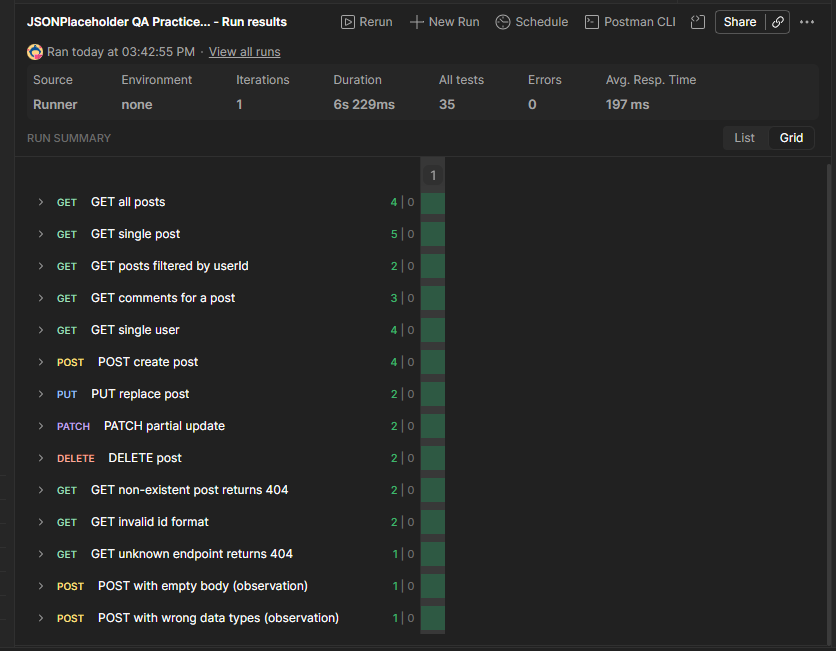

# API Testing Practice: Postman

A Postman collection of 14 requests with 35 assertions, run against [JSONPlaceholder](https://jsonplaceholder.typicode.com), a free mock REST API built for practice. It covers positive, negative and edge-case testing.

## Latest run

**5 Nov 2026: 14 requests, 35/35 assertions passed, 0 errors.**

## What it covers

| Folder | Requests | What it demonstrates |
|---|---|---|
| 1. Read (GET) | 5 | Status codes, response time, JSON fields and types, query-parameter filtering, nested resources, email format validation, nested field checks (`GET single user`) |
| 2. Create / Update / Delete | 4 | POST (201), PUT, PATCH and DELETE, and saving a response value to a collection variable |
| 3. Negative and edge cases | 5 | Non-existent id (404), invalid id format, unknown endpoint, empty body, wrong data types |

## How to run it

1. Install [Postman](https://www.postman.com/downloads/).
2. Click **Import** and select `JSONPlaceholder_QA_Practice.postman_collection.json`.
3. Right-click the collection, choose **Run collection**, then click **Run**.
4. Open the results to see which assertions passed or failed.

The base URL is stored in the collection variable `baseUrl`, so the same tests can be pointed at another API.

## Test design

- **Positive tests:** valid requests return the expected status, fields and data types.
- **Negative tests:** invalid ids and unknown endpoints return 4xx errors, not server errors.
- **Edge cases:** empty body and wrong data types are sent to see how the API responds.
- **Data validation:** email format is checked with a regular expression, and nested objects (`address.city`) are verified.

## Findings

- `POST /posts` with an empty body returned **201 Created**. JSONPlaceholder is a mock API and does not validate input. On a real system this should return **400 Bad Request**, so these two requests are logged as observations, not defects.
- Invalid ids (`/posts/abc`) and unknown routes return 404 without server errors.

## Skills shown

Postman collections and variables, JavaScript test scripts (`pm.test`, `pm.expect`), REST methods and status codes, positive and negative test design, and test documentation.

## Author

Nyagaka Renee Machini
Computer Science student, Multimedia University of Kenya
reneenyagaka@gmail.com
